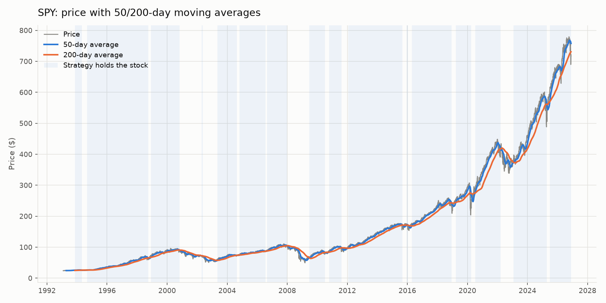
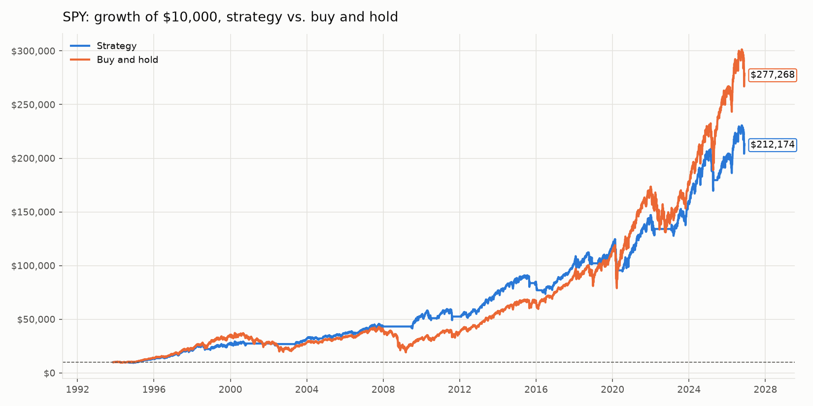

# MITS Backtester

[](https://github.com/mamoonrkhan/mits-backtester/actions/workflows/tests.yml)

A small, readable Python tool for **backtesting** trading strategies, built for the
Mathematical Investment and Trading Society (MITS). A backtest asks: *if I had followed
this rule in the past, how would it have done?*

Version 1 tests a classic **moving-average crossover** strategy and compares it with
simply buying and holding the stock over the same period.

## Example: SPY, 1993–2026

`python backtest.py --csv data/SPY.csv --short 50 --long 200`

| Metric                | 50/200 Crossover | Buy & Hold |
|-----------------------|-----------------:|-----------:|
| Total Return          |        2,021.7%  |   2,672.7% |
| CAGR                  |           9.70%  |     10.59% |
| Max Drawdown          |         -33.72%  |    -55.19% |
| Annualized Volatility |          13.87%  |     18.72% |
| Sharpe Ratio          |            0.74  |       0.63 |

*31 trades, invested 77% of the time. Data: Yahoo Finance (dividend-adjusted), 1993-11-11
to 2026-11-25.*

**Takeaway:** the crossover strategy ended with less money than buy-and-hold, but it
avoided most of the 2008 crash, so its worst drawdown was much smaller and its
return *per unit of risk* (Sharpe) was higher. This is typical of trend-following rules:
they trade some return for a smoother ride.




## How the strategy works

1. Compute the average closing price over the last **50** days (short) and the last
   **200** days (long).
2. If the short average is **above** the long one, the trend is up: **hold the stock**.
3. Otherwise, **hold cash** (earning 0%).

Both window lengths can be changed from the command line.

### Avoiding look-ahead bias

A signal is calculated from a day's *closing* price, so in real life you could only act
on it **after** the market closed. The backtester therefore applies each signal starting
the **next** trading day (`Position = Signal.shift(1)` in
[`engine.py`](mits_backtester/engine.py)).

Without this one-day delay, the backtest would quietly use information it couldn't have
had at the time. For example, it would "buy" on the same day a big rally pushes the
short average above the long one, and so capture the rally that caused the signal.
Results like that look great on paper and can't be reproduced in real trading. A test
in [`tests/test_backtest.py`](tests/test_backtest.py) checks this rule.

## Installation

Requires Python 3.10 or newer.

```bash
git clone https://github.com/mamoonrkhan/mits-backtester.git
cd mits-backtester
python3 -m venv .venv
source .venv/bin/activate        # Windows: .venv\Scripts\activate
pip install -r requirements.txt
```

## Usage

Run on the included sample data (synthetic prices, so it works right away):

```bash
python backtest.py --csv data/sample.csv
```

Download real data from Yahoo Finance and run on it:

```bash
python scripts/download_data.py SPY --start 1993-01-01
python backtest.py --csv data/SPY.csv --short 50 --long 200
```

You can also use a CSV downloaded by hand from the Yahoo Finance website. It needs at
least `Date` and `Close` columns. `Adj Close` is used when it is present.

| Option         | Default  | Meaning                               |
|----------------|----------|---------------------------------------|
| `--csv`        | required | Path to the price CSV                 |
| `--short`      | 50       | Short moving-average window (days)    |
| `--long`       | 200      | Long moving-average window (days)     |
| `--capital`    | 10000    | Starting amount in dollars            |
| `--output-dir` | output   | Where the PNG charts are saved        |

Run the tests with:

```bash
pytest
```

## What each metric means

All metrics are calculated from the daily portfolio value ("equity curve"). Annualized
figures assume **252 trading days per year**.

| Metric | Formula | In plain words |
|---|---|---|
| **Total Return** | `end / start - 1` | How much the money grew overall. |
| **CAGR** (compound annual growth rate) | `(end / start) ^ (1 / years) - 1` | The steady yearly growth rate that would produce the same result. Lets you compare periods of different lengths. |
| **Max Drawdown** | `min(value / running peak - 1)` | The worst drop from a high point to a later low. It shows how much pain you'd have had to sit through. |
| **Annualized Volatility** | `std(daily returns) × √252` | How much returns jump around. Higher means a bumpier ride. It's scaled by √252 because variance grows in proportion to time. |
| **Sharpe Ratio** | `mean(daily returns) / std(daily returns) × √252` | Return earned per unit of volatility (with a 0% risk-free rate). Higher is better. It's useful for comparing strategies that take different amounts of risk. |

## Project structure

```
backtest.py               Command-line entry point
mits_backtester/
    data.py               load_data(): read and clean the CSV
    strategies.py         compute_signals(): the moving-average crossover
    engine.py             run_backtest(): signals -> daily returns -> equity curves
    metrics.py            compute_metrics() and the individual metric functions
    plotting.py           plot_results(): saves the two PNG charts
scripts/
    download_data.py      Download prices from Yahoo Finance
    make_sample_data.py   Regenerate the synthetic data/sample.csv
tests/                    pytest tests with small, hand-checkable examples
```

Every strategy follows the same contract. It takes the price table and returns it with a
`Signal` column (1 = own the stock, 0 = hold cash). So a new strategy is just a new
function in `strategies.py`.

## Limitations

Version 1 makes some simplifying assumptions:

- No trading commissions, bid/ask spreads, or slippage.
- Cash earns 0% interest.
- The portfolio is either 100% in the stock or 100% in cash.
- A single backtest on one historical path. Past performance doesn't guarantee future
  results, and choosing parameters that worked best in the past can overfit.

## Future work

- **Monte Carlo risk simulation:** resample historical returns to see the range of
  possible outcomes and how likely large drawdowns are, instead of relying on one path.
- **User-defined strategies:** choose or plug in strategies (e.g. RSI, momentum) from the
  command line without editing the engine.
- **Multiple tickers:** backtest a portfolio of several stocks, or compare one strategy
  across many tickers at once.
- **Simple web interface:** a page where club members can upload a CSV, set parameters,
  and see the charts and metrics without using the terminal.
- Transaction costs and a non-zero risk-free rate.

## Disclaimer

Educational project. This is not investment advice.
