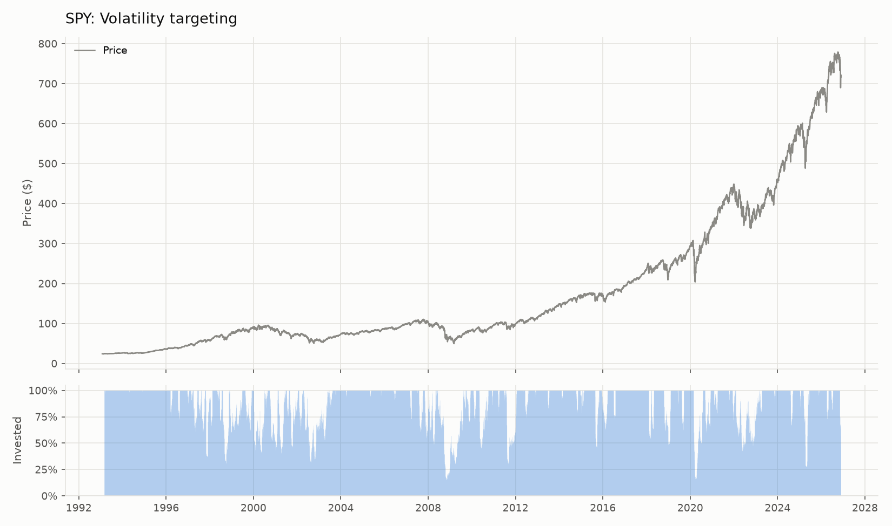
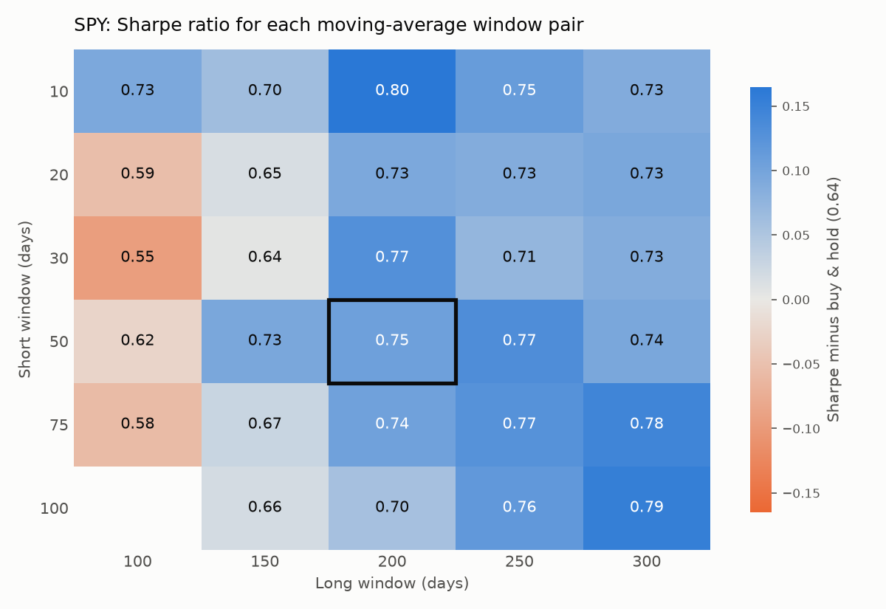

# MITS Backtester

[](https://github.com/mits-fhda/mits-backtester/actions/workflows/tests.yml)
[](https://mits-backtester.streamlit.app/)

Is there a smarter way to invest than buying an index fund and never touching it? People
have been arguing about that forever, so we built a tool to check.

The MITS Backtester takes a simple trading rule, like "sell when the market starts
trending down," and replays it day by day over 30 years of real market data. Then it
compares the result with someone who just bought and held the whole time.

We built it for the Mathematical Investment and Trading Society (MITS) so members can
test their own ideas instead of taking anyone's word for it.

**Try it in your browser: [mits-backtester.streamlit.app](https://mits-backtester.streamlit.app/)**.
There's nothing to install. Pick a ticker and a strategy and see what would have happened.

## What we found

We tested four well-known strategies on SPY (an S&P 500 fund) from 1994 to 2026, with a
small trading cost on every trade:

| Strategy | Return per year | Worst drop | Sharpe ratio |
|---|---:|---:|---:|
| Momentum | 10.3% | -34% | 0.74 |
| Moving-average crossover | 9.6% | -34% | 0.73 |
| Volatility targeting | 8.8% | -46% | 0.70 |
| Just buy and hold | 10.5% | -55% | 0.63 |
| Mean reversion | 4.5% | -32% | 0.43 |

None of the strategies really beat buy-and-hold on raw returns. The interesting part is
the worst drop. Holding SPY through 2008 meant watching more than half your money
disappear before it came back. The two trend-following rules got out early. The crossover
lost about 10% in that crash and momentum about 16%. Their worst moment was the COVID
crash in March 2020, which fell so fast that no trend rule could react in time. Overall
you end up with similar money and a much less stressful ride, which is what the higher
Sharpe ratio is saying.


Mean reversion ("buy the dip") was the surprise loser. With our settings it only buys
after unusually sharp drops, so it sat in cash about 80% of the time and missed most of
the market's growth.

## The four strategies

**Moving-average crossover.** Compare the average price over the last 50 days with the
average over the last 200. If the short one is higher, prices are trending up, so own the
stock. If not, sit in cash. This is probably the most famous rule in trading.


**Momentum.** If the stock went up over the past year, own it. We ignore the most recent
month, because research has found that very short-term moves tend to reverse.

**Mean reversion.** If the price suddenly falls well below its recent average, buy it and
bet on a bounce. "Well below" means more than one standard deviation under the 20-day
average.

**Volatility targeting.** Always stay invested, but own less when the market gets jumpy.
Wild days tend to come in clusters, and crashes happen during those clusters. You can see
it cut its position to under 25% in both 2008 and 2020:



## How we keep it honest

It's easy to build a backtest that looks amazing and is completely fake. We tried to
avoid the usual traps.

**No peeking at the future.** Each signal is based on a day's closing price, so in real
life you couldn't act on it until the market closed. The backtester only lets a signal
affect your position starting the *next* day. Skip that and the backtest quietly buys
right before the rallies that caused its own buy signals. There's a test that checks this
([`tests/test_backtest.py`](tests/test_backtest.py)).

**Trading isn't free.** You can charge a cost on every buy and sell (`--cost-bps 5` means
0.05%). The results above include it.

**Did we just get lucky with 50 and 200?** We tried 29 different window pairs. 25 of them
had a better Sharpe ratio than buy-and-hold, and the good ones are clustered together
rather than scattered. That suggests the trend effect is real, at least on SPY, and that
we didn't cherry-pick 50/200. The outlined square is the 50/200 pair:



**History only happened once.** A different order of good and bad years could have given
very different results. So we also run a Monte Carlo simulation. It cuts the real daily
returns into 20-day chunks, shuffles them into 2,000 new 10-year histories, and runs both
approaches through each one. (Shuffling single days would hide how crashes come in
streaks, which is why we use chunks.)

Across those 2,000 simulated decades, buy-and-hold had a 58% chance of a 30%+ drop at some
point. The crossover strategy had a 20% chance. Buy-and-hold still finished ahead more
often, about 61% of the time.


## Running it yourself

You'll need Python 3.10 or newer.

```bash
git clone https://github.com/mits-fhda/mits-backtester.git
cd mits-backtester
python3 -m venv .venv
source .venv/bin/activate        # on Windows: .venv\Scripts\activate
pip install -r requirements.txt
```

To try it right away on the included sample data (made-up prices, so it works offline):

```bash
python backtest.py --csv data/sample.csv
```

To use real data, download it first and then run the backtest:

```bash
python scripts/download_data.py SPY --start 1993-01-01
python backtest.py --csv data/SPY.csv
```

A few more things you can do:

```bash
python backtest.py --csv data/SPY.csv --strategy momentum      # pick a strategy
python backtest.py --csv data/SPY.csv --compare                # leaderboard of all four
python backtest.py --csv data/SPY.csv --monte-carlo 2000       # Monte Carlo simulation
python backtest.py --csv data/SPY.csv --sweep                  # try 29 window pairs
streamlit run app.py                                           # the web app, locally
pytest                                                         # run the tests
```

Charts are saved as PNG files in the `output/` folder.

<details>
<summary>All command-line options</summary>

| Option | Default | What it does |
|---|---|---|
| `--csv` | required | Price file (Yahoo Finance format, needs at least `Date` and `Close`) |
| `--strategy` | `sma` | `sma`, `momentum`, `mean_reversion` or `vol_target` |
| `--short`, `--long` | 50, 200 | Moving-average windows in days |
| `--lookback`, `--skip` | 252, 21 | Momentum: how far back to look, and recent days to ignore |
| `--window`, `--entry-z` | 20, -1.0 | Mean reversion: average window and how far below it to buy |
| `--target-vol`, `--vol-window` | 0.15, 20 | Volatility targeting: target yearly volatility and the window used to measure it |
| `--cost-bps` | 0 | Cost per trade in basis points (5 = 0.05%) |
| `--capital` | 10000 | Starting amount in dollars |
| `--compare` | off | Run every strategy on the same dates and rank them |
| `--sweep` | off | Try 29 moving-average window pairs and draw a heatmap |
| `--monte-carlo` | 0 (off) | Number of simulated paths, e.g. 2000 |
| `--mc-years` | 10 | Length of each simulated path in years |
| `--block-size` | 20 | Days per shuffled chunk (1 = shuffle single days) |
| `--seed` | 42 | Random seed, so you get the same results every run |
| `--output-dir` | `output` | Where the charts are saved |

</details>

## What the numbers mean

The two that matter most are the **Sharpe ratio**, which is return per unit of stress (a
higher number is better), and the **max drawdown**, the worst fall from a high point
(closer to zero is better). A strategy that makes a bit less money but never loses half
your savings can be the better deal.

<details>
<summary>Every metric, with its formula</summary>

All of these come from the daily portfolio value. "Per year" figures assume 252 trading
days in a year.

| Metric | Formula | What it tells you |
|---|---|---|
| Total return | end / start − 1 | How much the money grew overall |
| CAGR | (end / start)^(1/years) − 1 | The average yearly growth rate |
| Max drawdown | min(value / previous peak − 1) | The worst drop you'd have had to sit through |
| Volatility | std(daily returns) × √252 | How bumpy the ride was |
| Sharpe ratio | mean(daily returns) / std(daily returns) × √252 | Return for each unit of bumpiness (assuming cash earns 0%) |
| Sortino ratio | mean(daily returns) / downside deviation × √252 | Like Sharpe, but only counts down days as risk |
| Calmar ratio | CAGR / \|max drawdown\| | Yearly return for each unit of worst-case pain |
| Daily VaR (95%) | 5th percentile of daily returns | On 19 days out of 20, you lose less than this |
| Daily CVaR (95%) | average of the worst 5% of days | How bad those 1-in-20 days get on average |
| Beta | cov(strategy, market) / var(market) | How much it moves with the market (1 = exactly like it) |
| Alpha | (mean return − beta × market mean) × 252 | Yearly return that isn't explained by riding the market |

</details>

## What it doesn't do (yet)

Treat this as a learning tool, not a trading system. In particular:

- It tests one stock or fund at a time.
- Cash earns nothing, and there's no shorting or borrowing to invest more than 100%.
- Trades happen at the closing price on the day of the signal. Trading at the next
  morning's open would give slightly different numbers because prices can jump overnight.
- Taxes are ignored, and trading costs are a flat percentage.
- The Monte Carlo simulation reshuffles each strategy's actual past daily returns. It
  doesn't re-run the strategy on brand-new prices, so it can't tell you whether a rule
  would still work in a completely different kind of market.
- Every result here comes from looking back at history. The settings were never tested
  on data they hadn't already "seen," which is the next thing we want to add.

Ideas we'd like to build next:
- out-of-sample testing
- portfolios of several tickers
- more strategies (RSI, Bollinger breakouts, combining trend with volatility targeting)
- a realistic interest rate on cash

## How the code is organized

```
backtest.py                 command-line tool
app.py                      web app (display only, uses the same code as the CLI)
mits_backtester/
    data.py                 loads and cleans price data
    strategies.py           the four strategies
    engine.py               runs a strategy day by day
    metrics.py              Sharpe, drawdown, VaR and the rest
    montecarlo.py           the Monte Carlo simulation
    sweep.py                the 29-window-pair test
    compare.py              the strategy leaderboard
    plotting.py             all the charts
scripts/                    download real data, regenerate the sample data
tests/                      52 tests, most with small examples you can check by hand
```

## Want to help?

You don't need to be an expert. Adding a strategy means writing one Python function,
and [CONTRIBUTING.md](CONTRIBUTING.md) walks you through it step by step. Questions and
ideas go in [Discussions](https://github.com/mits-fhda/mits-backtester/discussions).

---

This is a student project for learning. It isn't investment advice.
Licensed under [MIT](LICENSE).
