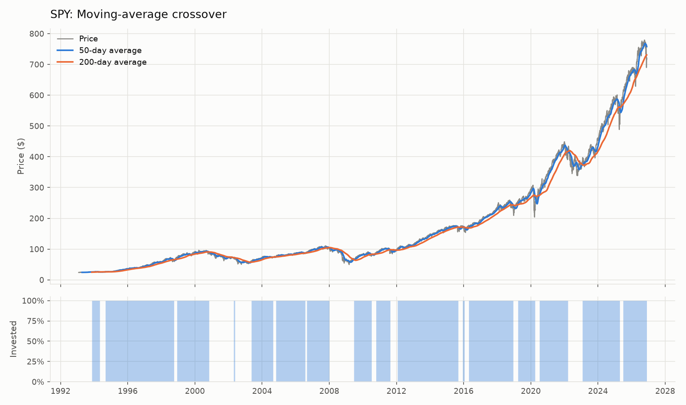
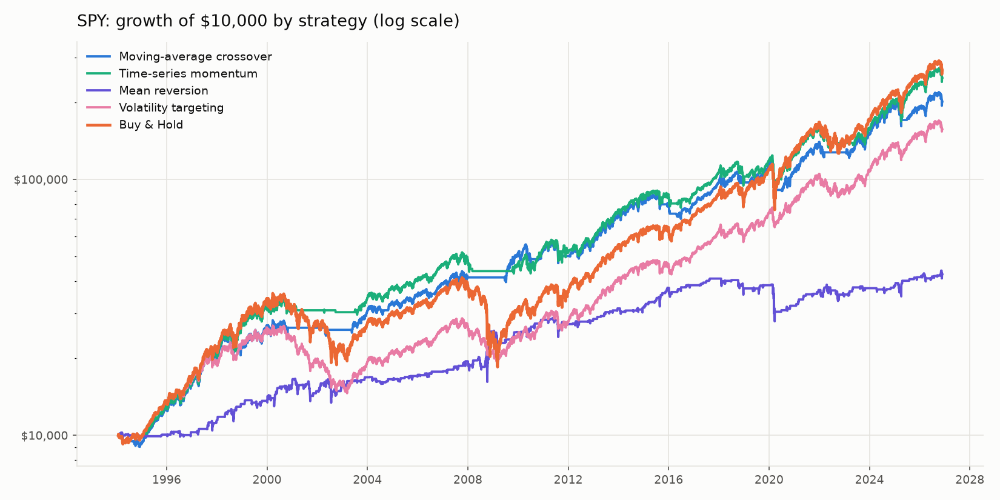
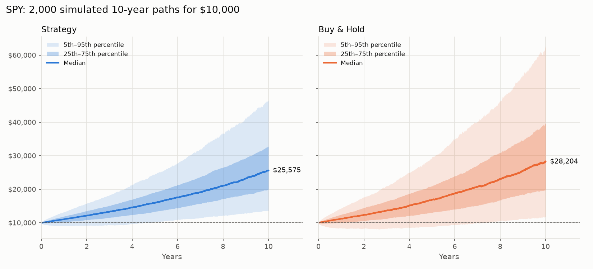
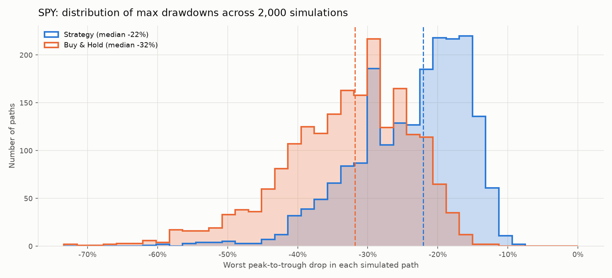

# MITS Backtester

[](https://github.com/mamoonrkhan/mits-backtester/actions/workflows/tests.yml)
[](https://mits-backtester.streamlit.app/)

A small, readable Python tool for **backtesting** trading strategies, built for the
Mathematical Investment and Trading Society (MITS). A backtest asks: *if I had followed
this rule in the past, how would it have done?*

It tests four classic quant strategies (trend following, momentum, mean reversion and
volatility targeting) against simply buying and holding. It scores them with the risk
metrics professional funds use (Sharpe, Sortino, VaR/CVaR, beta, alpha), and uses a **Monte
Carlo simulation** to estimate the range of outcomes and drawdowns you could face going
forward.
A **parameter sweep** checks whether the result is robust or just lucky, and an
**interactive web app** lets anyone try it on any ticker without touching the code.

## Example: SPY, 1993–2026

`python backtest.py --csv data/SPY.csv --short 50 --long 200 --cost-bps 5 --monte-carlo 2000`

| Metric                | 50/200 Crossover | Buy & Hold |
|-----------------------|-----------------:|-----------:|
| Total Return          |        1,989.1%  |   2,672.7% |
| CAGR                  |           9.65%  |     10.59% |
| Max Drawdown          |         -33.72%  |    -55.19% |
| Annualized Volatility |          13.87%  |     18.72% |
| Sharpe Ratio          |            0.73  |       0.63 |

*31 trades, invested 77% of the time, 5 bps (0.05%) trading cost per trade. Data: Yahoo
Finance (dividend-adjusted), 1993-11-11 to 2026-11-25.*

**Takeaway:** the crossover strategy ended with less money than buy-and-hold, but it
avoided most of the 2008 crash, so its worst drawdown was much smaller and its
return *per unit of risk* (Sharpe) was higher. This is typical of trend-following rules:
they trade some return for a smoother ride.




## Strategy leaderboard

`python backtest.py --csv data/SPY.csv --cost-bps 5 --compare`

All four strategies with their default settings, on the same dates (1994–2026), sorted by
Sharpe ratio:

| Strategy | CAGR | Max DD | Volatility | Sharpe | Sortino | Beta | Alpha | Avg exposure |
|---|---:|---:|---:|---:|---:|---:|---:|---:|
| Time-series momentum     | 10.31% | -33.7% | 14.8% | 0.74 | 1.04 | 0.62 | 3.58% | 82% |
| Moving-average crossover |  9.59% | -33.7% | 13.9% | 0.73 | 1.03 | 0.55 | 3.67% | 77% |
| Volatility targeting     |  8.77% | -45.6% | 13.4% | 0.70 | 0.97 | 0.65 | 1.61% | 88% |
| Buy & Hold               | 10.54% | -55.2% | 18.8% | 0.63 | 0.89 | 1.00 | 0.00% | 100% |
| Mean reversion           |  4.52% | -32.0% | 12.0% | 0.43 | 0.65 | 0.41 | 0.31% | 19% |

**What it shows:**
- The two trend-following strategies (momentum and the crossover) give up a little
  return but cut the worst crash by about 20 percentage points.
- Their **beta around 0.6** means they carry only about 60% of the market's risk, and
  **alpha around 3.6% a year** is the return left over after accounting for that.
- Mean reversion has the smallest drawdown but the lowest return. With these settings it's
  invested only 19% of the time, so it misses most of the market's long-run growth.



Volatility targeting is always invested but shrinks its position when markets get wild.
In the panel below, you can see it cut exposure to under 25% in the 2008 and 2020 crashes:


## Monte Carlo risk simulation

A backtest shows only **one** path: the one history happened to take. A different
sequence of good and bad years could have produced very different results. The Monte Carlo
simulation builds thousands of alternative 10-year histories out of pieces of the real
one and asks what range of outcomes is plausible.

**How it works (block bootstrap):** chop the historical daily returns into random
20-day chunks and glue them together into new 10-year paths. Chunks are used instead of
single days because markets have streaks: crashes and calm periods cluster, and
shuffling individual days would make crashes look milder than they really are. The
strategy and buy-and-hold are resampled with the **same random dates**, so in every
simulated history they face exactly the same market.

| 2,000 simulated 10-year paths, $10,000 start | Strategy | Buy & Hold |
|---|---:|---:|
| Final value: 5th percentile (a bad outcome)  | $13,549 | $11,800 |
| Final value: median                           | $25,575 | $28,204 |
| Final value: 95th percentile (a great outcome) | $46,493 | $62,518 |
| Max drawdown: median                          | -22.1% | -31.8% |
| Max drawdown: 5th percentile (a bad outcome)  | -38.3% | -50.0% |
| Chance of losing money after 10 years         | 0.9% | 2.8% |
| Chance of a drawdown of 30% or worse          | 20.4% | 57.9% |

The strategy ended ahead of buy-and-hold in 38.9% of simulations. The simulation confirms
the single backtest: buy-and-hold has the higher typical return, but the crossover
strategy narrows the range of outcomes, so its bad cases are less bad and deep drawdowns
are about a third as likely.




**A limitation to keep in mind:** the simulation resamples the strategy's *realized*
daily returns. It does not re-run the moving-average rule on new simulated prices. So it
measures how sensitive the results are to the *order* of good and bad periods, not
whether the rule itself would keep working in a different kind of market.

## Is 50/200 special, or just lucky?

`python backtest.py --csv data/SPY.csv --cost-bps 5 --sweep`

Picking the best-looking settings after the fact is the most common way backtests fool
people (*overfitting*). The sweep tests 29 short/long window pairs over the same dates.
**25 of 29 beat buy-and-hold's Sharpe ratio**, and the good results form a broad region
instead of a single lucky cell. The only pairs that did worse all used a 100-day long window. So
the trend-following effect looks robust on SPY, and 50/200 (outlined) isn't a cherry-picked
outlier.


## Interactive web app

**Try it online: [mits-backtester.streamlit.app](https://mits-backtester.streamlit.app/)** (no install needed).

To run it on your own computer:

```bash
streamlit run app.py
```

This opens a page in your browser where you can type any ticker, move sliders for the
windows and trading cost, and see the backtest, Monte Carlo and parameter sweep update
live. You can also upload your own CSV. The app ([`app.py`](app.py)) contains only display
code. It calls the same tested functions as the command-line tool.

**Share it with the club for free:** push to GitHub, sign in at
[share.streamlit.io](https://share.streamlit.io) with your GitHub account, click
"Create app", choose this repo and `app.py`, and deploy. You get a public link anyone can
open.

## The strategies

| `--strategy` | Rule | Idea behind it |
|---|---|---|
| `sma` (default) | Own the stock while its 50-day average is above its 200-day average | Ride long trends, step aside in downtrends |
| `momentum` | Own it if the past 12 months' return (skipping the latest month) is positive | Winners tend to keep winning for a while; the skip avoids short-term reversals |
| `mean_reversion` | Own it while the price is more than 1 standard deviation below its 20-day average | Sharp drops tend to partly bounce back |
| `vol_target` | Always invested, sized as 15% ÷ recent volatility (max 100%) | Volatility clusters, so cutting size when it rises avoids the worst of crashes |

Every strategy is a function in [`strategies.py`](mits_backtester/strategies.py) that
returns a `Signal` between 0 (all cash) and 1 (fully invested). Adding a new strategy
means writing one function and adding one line to the `STRATEGIES` table.

### Avoiding look-ahead bias

A signal is calculated from a day's *closing* price, so in real life you could only act
on it **after** the market closed. The backtester therefore applies each signal starting
the **next** trading day (`Position = Signal.shift(1)` in
[`engine.py`](mits_backtester/engine.py)).

Without this one-day delay, the backtest would quietly use information it couldn't have
had at the time. For example, it would "buy" on the same day a big rally pushes the
short average above the long one, and so capture the rally that caused the signal.
Results like that look great on paper and can't be reproduced in real trading. A test
in [`tests/test_backtest.py`](tests/test_backtest.py) checks this rule.

## Installation

Requires Python 3.10 or newer.

```bash
git clone https://github.com/mamoonrkhan/mits-backtester.git
cd mits-backtester
python3 -m venv .venv
source .venv/bin/activate        # Windows: .venv\Scripts\activate
pip install -r requirements.txt
```

## Usage

Run on the included sample data (synthetic prices, so it works right away):

```bash
python backtest.py --csv data/sample.csv
```

Download real data from Yahoo Finance and run on it:

```bash
python scripts/download_data.py SPY --start 1993-01-01
python backtest.py --csv data/SPY.csv --short 50 --long 200
```

You can also use a CSV downloaded by hand from the Yahoo Finance website. It needs at
least `Date` and `Close` columns. `Adj Close` is used when it is present.

| Option         | Default  | Meaning                               |
|----------------|----------|---------------------------------------|
| `--csv`        | required | Path to the price CSV                 |
| `--strategy`   | sma      | `sma`, `momentum`, `mean_reversion` or `vol_target` |
| `--compare`    | off      | Run every strategy on the same dates and print a leaderboard |
| `--short`      | 50       | Short moving-average window (days)    |
| `--long`       | 200      | Long moving-average window (days)     |
| `--lookback`, `--skip` | 252, 21 | Momentum: look-back period and recent days to ignore |
| `--window`, `--entry-z` | 20, -1.0 | Mean reversion: average window and buy threshold |
| `--target-vol`, `--vol-window` | 0.15, 20 | Volatility targeting: target and measurement window |
| `--capital`    | 10000    | Starting amount in dollars            |
| `--output-dir` | output   | Where the PNG charts are saved        |
| `--cost-bps`   | 0        | Trading cost per buy/sell in basis points (5 = 0.05%) |
| `--monte-carlo`| 0 (off)  | Number of Monte Carlo paths, e.g. 1000 |
| `--mc-years`   | 10       | Length of each simulated path (years) |
| `--block-size` | 20       | Days per resampled block (1 = independent days) |
| `--seed`       | 42       | Random seed, so results are repeatable |
| `--sweep`      | off      | Test 29 window pairs and save a Sharpe heatmap |

Run the tests with:

```bash
pytest
```

## What each metric means

All metrics are calculated from the daily portfolio value ("equity curve"). Annualized
figures assume **252 trading days per year**.

| Metric | Formula | In plain words |
|---|---|---|
| **Total Return** | `end / start - 1` | How much the money grew overall. |
| **CAGR** (compound annual growth rate) | `(end / start) ^ (1 / years) - 1` | The steady yearly growth rate that would produce the same result. Lets you compare periods of different lengths. |
| **Max Drawdown** | `min(value / running peak - 1)` | The worst drop from a high point to a later low. It shows how much pain you'd have had to sit through. |
| **Annualized Volatility** | `std(daily returns) × √252` | How much returns jump around. Higher means a bumpier ride. It's scaled by √252 because variance grows in proportion to time. |
| **Sharpe Ratio** | `mean(daily returns) / std(daily returns) × √252` | Return earned per unit of volatility (with a 0% risk-free rate). Higher is better. It's useful for comparing strategies that take different amounts of risk. |
| **Sortino Ratio** | `mean(daily returns) / downside deviation × √252` | Like Sharpe, but only *down* days count as risk. Nobody minds big up days. |
| **Calmar Ratio** | `CAGR / \|max drawdown\|` | Yearly return per unit of worst-case pain. |
| **Daily VaR (95%)** | 5th percentile of daily returns | Value-at-Risk: "on 19 days out of 20, we lose less than this." |
| **Daily CVaR (95%)** | average of the worst 5% of days | Expected Shortfall: how bad the bad days get. Regulators now prefer it to VaR. |
| **Beta** | `cov(strategy, market) / var(market)` | How much the strategy moves with the market (1 = exactly like it). |
| **Alpha** | `(mean return − beta × market mean) × 252` | Yearly return *not* explained by market exposure. It's what quant funds are paid for. |

## Project structure

```
backtest.py               Command-line entry point
mits_backtester/
    data.py               load_data(): read and clean the CSV
    strategies.py         four strategies + the STRATEGIES registry
    engine.py             run_backtest(): signals -> daily returns -> equity curves
    metrics.py            compute_metrics() and the individual metric functions
    montecarlo.py         run_monte_carlo(): block-bootstrap risk simulation
    sweep.py              parameter_sweep(): test many window pairs on the same dates
    compare.py            compare_strategies(): the strategy leaderboard
app.py                    Streamlit web app (display only; reuses the functions above)
    plotting.py           plot_results(): saves the two PNG charts
scripts/
    download_data.py      Download prices from Yahoo Finance
    make_sample_data.py   Regenerate the synthetic data/sample.csv
tests/                    pytest tests with small, hand-checkable examples
```

Every strategy follows the same contract. It takes the price table and returns it with a
`Signal` column (1 = own the stock, 0 = hold cash). So a new strategy is just a new
function in `strategies.py`.

## Limitations

The backtester makes some simplifying assumptions:

- Trading costs are a flat percentage per trade (`--cost-bps`). Taxes are ignored.
- Trades are assumed to fill at the closing price of the signal day, so the new position
  earns the *next* day's return. In practice that means trading right at the close
  (e.g. a market-on-close order). Trading at the next morning's open would give slightly
  different results because of overnight price gaps.
- Cash earns 0% interest.
- The portfolio is either 100% in the stock or 100% in cash.
- A single backtest on one historical path. Past performance doesn't guarantee future
  results, and choosing parameters that worked best in the past can overfit.

## Future work

- ~~**Monte Carlo risk simulation**~~: done in v1.1 (see above).
- ~~**More strategies**~~: momentum, mean reversion and volatility targeting added in v1.3.
  Next ideas: RSI, Bollinger breakouts, combining signals (e.g. trend + vol targeting).
- **Multiple tickers:** backtest a portfolio of several stocks, or compare one strategy
  across many tickers at once.
- ~~**Simple web interface**~~: done in v1.2 (`streamlit run app.py`).
- **Out-of-sample testing:** choose windows on one period (e.g. 1994–2010) and check
  them on a later one (2011–today), a stricter guard against overfitting than the sweep.
- A non-zero risk-free rate, so cash earns interest (this affects Sharpe, Sortino and alpha).
- **Short selling and leverage**, so strategies can bet on prices falling.

## Disclaimer

Educational project. This is not investment advice.

## License

MIT. See [LICENSE](LICENSE).
